<p align="center">
  
</p>

# Successor

> CoinMarketCap tells you a coin migrated, but only in prose. Successor reads the notice, finds the successor
> token, verifies it against CMC's own data and gives the holder one verdict with the rows that prove it.

**Status: building.** Live at https://successor.edycu.dev: the board streams a real lookup (CoinMarketCap +
the Reader) through the verdict table in `successor/verify/verdict.py`, with every CMC row in the receipt. The
full README (endpoints, evidence, limits) arrives with the first release.

## Run locally

```bash
uv venv && uv pip install -e '.[dev]'
export CMC_API_KEY=...        # CoinMarketCap Pro API key
export DASHSCOPE_API_KEY=...  # Qwen on Alibaba Cloud DashScope (intl)
uvicorn api.index:app --reload
curl -N 'localhost:8000/api/lookup?q=CPOOL&qty=10000'
```

## Tests

```bash
pytest -q
```

## License

MIT
