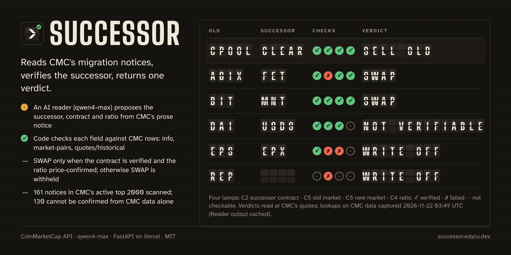
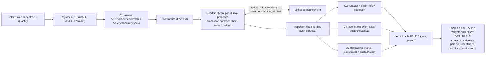

<div align="center">
  
  <h1>Successor 🛫</h1>
  <p><em>CoinMarketCap says a coin migrated, but only in prose. Successor reads the notice, finds the successor token, checks it against CMC's own rows, and gives the holder one verdict.</em></p>
  

  <br/>

  [](https://successor.edycu.dev)
  [](https://dorahacks.io/hackathon/coinmarketcap-api-202611/detail)

  <br/>

  
  
  
  
  
  [](https://github.com/edycutjong/successor/releases)
  [](https://opensource.org/licenses/MIT)

</div>

---

**No wallet needed anywhere. Every lookup is a read-only call to CoinMarketCap and, when a notice is new, one Qwen call.**
Why it matters, in one example (CMC quotes, 2026-11-22 03:49 UTC): a tracker shows **$5,924.93** for 10,000 AGIX, which has traded $0 in 24 h; swapped into FET at the ratio the agent found and code price-confirmed, the same coins are **$463.42**.
Try it: https://successor.edycu.dev (judges: [/judge](https://successor.edycu.dev/judge), the 30-second path), or `curl -N 'https://successor.edycu.dev/api/lookup?q=CPOOL&qty=10000'`.

## 📸 See it in Action

<p align="center">
  
</p>

The board above is six real lookups captured on **2026-11-22 03:49 UTC** (raw streams in `docs/proof/assets/`).
Every verdict is market-sensitive, so each one carries its capture time.

| Holding | Verdict | Why (from the captured stream) |
|---|---|---|
| CPOOL | **SELL OLD** (rule R8) | CPOOL was renamed to CLEAR with a 1:1 swap; at CMC's quotes the old token is worth 15.7% more than the swap (old $0.0243011 vs 1 × new $0.0210…) |
| AGIX | **SWAP** (R9) | The notice links `fetch.ai`; the Reader reads ratio 0.43335 there; code confirmed it with CMC prices on the event date. 10,000 AGIX: $5,924.93 at the old price (a tracker), $463.42 as FET after the swap |
| BIT | **SWAP** (R9) | Ratio 1, price-confirmed on the event date |
| EPS | **WRITE OFF** (R6) | CMC shows no market to exit through for the old token or the successor |
| REP | **WRITE OFF** (R6) | Same rule |
| DAI | **NOT VERIFIABLE** (R10) | Ratio not stated and the linked announcement could not be fetched |

## 💡 The Problem & Solution

### The Problem
When a token is renamed, migrated or redenominated, CMC records it in one free-text `notice` field on the coin's page. The
contract, the ratio and the deadline sit inside prose and markdown links. Trackers keep showing the old ticker at a price
that no longer means what the holder thinks it means: in the AGIX case above, a tracker shows $5,924.93 for 10,000 AGIX
while the same coins swapped into FET are $463.42 (CMC quotes, 2026-11-22 03:49 UTC).

How big is it? On the census served at `/api/census` (scan captured 2026-11-22T02:32:34Z, active top 2000 by CMC rank): **161 coins carry a
notice, 141 of them migration-type**, and 80 name the successor only in prose. That is a field a program cannot read, and a
holder should not have to.

### The Solution
An agent with a hard split of roles:

- **Reader (Qwen `qwen4-max`, a tool-using loop).** Reads the notice, may open links the coin's own CMC page lists
  (`follow_link`), and *proposes* the successor name and symbol, contract, chain, ratio and deadline, each with the quote it
  came from.
- **Inspector (plain code).** Verifies every proposal against CMC rows: the contract against CMC's contract list for the
  successor, the chain, the ratio against historical quotes on the event date (it confirms within ±5%, `TOL` in `successor/verify/ratio.py`), whether both tokens still trade. Then a
  deterministic table of rules (R1 to R10, `successor/verify/verdict.py`) picks the verdict.

The LLM never decides the verdict. SWAP is only produced when the successor is verified against CMC's data (its contract
matches, the notice links its CMC page, or it is the only CMC id with that exact name and symbol) and the ratio is
price-confirmed; a contract the Reader quoted that fails to match blocks SWAP. Otherwise SWAP is withheld, and a claim that fails a check ends as NOT VERIFIABLE, SELL OLD or WRITE OFF as the table says.
The four verdicts are **SWAP · SELL OLD · WRITE OFF · NOT VERIFIABLE**, plus NOTHING TO DO when the coin you hold is already
the successor. The wording is "what CMC's data supports", not advice. Fees, gas and slippage are excluded and said so on screen.

## 🏗️ Architecture & Tech Stack



| Layer | Choice |
|---|---|
| Runtime | Python 3.11, FastAPI as one Vercel serverless function (`api/index.py`, `maxDuration` 60), streaming NDJSON |
| Front end | Plain HTML/CSS/JS in `public/` (a departure board: split-flap names, lamps, trace, receipt drawer). No build step |
| LLM | Qwen `qwen4-max` on Alibaba Cloud DashScope (intl), fallback `qwen3.8-max-0902`. The Reader's extraction for a notice is cached by coin and notice hash in `data/extractions/` |
| Data | CoinMarketCap Pro API only. Prices, contracts and notices are never taken from the LLM |
| State | None: committed JSON (`data/`) for the extraction cache and census, no database |

## 🏆 CoinMarketCap API Integration

Endpoints Successor calls (5 to 12 calls per lookup in the captured streams; `info?address=` only when you paste a contract or the Reader quotes one; `key/info` from the credit guard at most every 10 minutes (cached) and from `/api/health` on every request). All are verbatim in the receipt drawer and in `docs/proof/spike/`:

| Endpoint | Used for |
|---|---|
| `GET /v1/cryptocurrency/map` (`listing_status=active,inactive,untracked`) | Resolve a symbol, slug or contract to CMC ids; exposes symbol collisions (`CLEAR` maps to 2 coins) |
| `GET /v2/cryptocurrency/info` (`aux=notice`, and `?address=`) | The notice itself; every chain's contract for equality checks against what the Reader proposed |
| `GET /v2/cryptocurrency/quotes/historical` | Prices of old and new token on the event date, to confirm the swap ratio |
| `GET /v2/cryptocurrency/quotes/latest` | Current price and 24 h volume, for the live value of "swap" against "sell old" |
| `GET /v2/cryptocurrency/market-pairs/latest` | Whether the old token still trades on spot pairs |
| `GET /v1/key/info` | Credits left and monthly limit, shown on `/api/health` |

### One real call: code and response

Code, `successor/cmc.py` (`CmcClient.info`, abridged):

```python
params: dict[str, Any] = {"aux": aux}  # default aux = "urls,platform,date_added,notice,status"
if ids:
    params["id"] = ",".join(map(str, ids))
if address:
    params["address"] = address
return await self.get("/v2/cryptocurrency/info", params)
```

Response, verbatim fields from `docs/proof/spike/01-info.json` (HTTP 200, 1 credit, captured 2026-11-22T01:24:19Z):

```json
"12573": {"id": 12573, "symbol": "CPOOL", "name": "Clearpool",
  "notice": "Clearpool (CPOOL) has rebranded to Clearpool (CLEAR) and undergone a 1:1 swap from the [old contract](https://etherscan.io/token/0x66761fa41377003622aee3c7675fc7b5c1c2fac5) to [new contract](https://etherscan.io/token/0x5200f539478f58d9aea962095ba3b16b5e550e00). For more details, please [click here](https://x.com/ClearpoolFin/status/2122523453270180117)."}
"42884": {"id": 42884, "symbol": "CLEAR", "name": "Clearpool",
  "platform": {"name": "Ethereum", "token_address": "0x5200f539478f58d9aea962095ba3b16b5e550e00"}}
```

The notice is prose; the successor's contract is a field on another coin. The Reader proposes `0x5200…0e00` from the
prose and code compares it with CLEAR's `token_address` (check C2). Every lookup's calls and raw rows are in the receipt drawer.

Successor's own endpoints: `GET /api/lookup?q=&qty=&id=&fresh=` (NDJSON trace, or one JSON answer with
`Accept: application/json`), `GET /api/hero`, `GET /api/notices`, `GET /api/census`, `GET /api/health`.

Why this is not "a plain API call": the information is not in a field. `info` returns prose; no endpoint returns "the
successor of CPOOL is CLEAR, 1:1". The agent has to read, propose and then be checked by the endpoints above. `docs/DX-REPORT.md`
lists what made this possible and what got in the way (`quotes/latest` stamps a fresh `last_updated` on a $0-volume coin, which is why a tracker-style last price can look current (AGIX: $0 of 24 h volume, `last_updated` a minute before the capture, `docs/proof/assets/lookup-AGIX-2026-11-22T0349Z.ndjson`); a checksummed-address 400 with a misleading message, `date_added`
copied from old to new coin, `convert=EUR` scaling supply, and the notice being free text).

## 📊 Engineering Rigor

| Metric | Value | How to reproduce |
|---|---|---|
| Tests | **83 passed**, 82 % line coverage (gate 70 %), mypy clean | `make test-coverage`, `make typecheck` |
| Evals | **10/10** counted cases + 4/4 variants (a variant re-runs a case with a field stripped or a second capture; reported, not counted) | `python scripts/run_evals.py` (replays real saved CMC rows and recorded Reader output) |
| Lookup latency, cached Reader read, live CMC calls | **p50 1.007 s · p95 1.454 s (= max at n=12)** (n=12, 2026-11-22 04:29 UTC). Re-measured on HEAD 0f2e719, 2026-11-22 11:16 UTC: p50 0.796 s · p95 1.363 s (n=12, `docs/proof/bench/bench-cached-2026-11-22T1116Z.json`); an earlier run that hour hit one slow call (p95 5.148 s, n not recorded, file overwritten), so the p95 is network-dependent. | `python scripts/bench.py https://successor.edycu.dev CPOOL 12`, samples in `docs/proof/bench/` |
| Lookup latency, cold Reader read (`fresh=1`, one Qwen call, live CMC calls) | **p50 15.44 s · p95 21.45 s (= max at n=6)** (n=6, CPOOL, 2026-11-22 05:22 UTC); earlier single samples 16.89 s (CPOOL), 8.79 s (MKR) on the day-one engine | `make bench-cold`, samples in `docs/proof/bench/bench-cold-2026-11-22.json`, `docs/proof/deploy/` |
| Census | 161 notices; verdicts over them: NOT VERIFIABLE 130 · NOTHING TO DO 26 · WRITE OFF 3 · SWAP 2 · SELL OLD 0 (verdicts captured 2026-11-22T03:45:14Z) | `GET /api/census`, `python scripts/census.py` |
| Live-URL E2E | **12 browser + API tests pass** on https://successor.edycu.dev (open, click CPOOL/AGIX, assert verdict + receipt, `/judge` with no auth, 3 viewports), 2026-11-22 | `make e2e` |
| Unplug test | No CMC key: error and no verdict. No LLM key on a cold notice: NOT VERIFIABLE. With every key removed the E2E tests fail | `tests/test_unplugged.py`, `tests/test_unplugged_http.py`, `make unplug-e2e` (`docs/proof/unplug/`) |
| Security | pip-audit: no known vulnerabilities (after moving to fastapi 0.165 / starlette 1.10: 11 advisories on 0.46.2); gitleaks: no leaks in the full history; CodeQL + Dependabot configured | `make audit`, `make secrets`, `docs/proof/gates/` |
| Lighthouse (desktop, live) | home: performance 82-83, accessibility 96, best practices 100, SEO 100; `/judge`: 100 / 93 / 100 / 100 (2026-11-22) | `make lighthouse` |

The census numbers are the honest headline: **most notices cannot be confirmed from CMC's data alone.** 130 of 161 end in NOT
VERIFIABLE, and the page says why (61: old and new token share one CMC page, 26: the proposed successor fails a check against CMC's records, such as a quoted contract no CMC coin carries, 22: the notice
names no successor, 10: no ratio or announcement unfetchable, 11 more: no live successor market 5, a "swap" the notice text does not show 3, a quote not in the notice 2, other 1). A tool that said SWAP for those would be guessing.

### Attacks defeated

| Control | Why it is load-bearing | Test |
|---|---|---|
| A contract that is one hex digit off is refuted, never repaired | A Reader that mistypes an address must not be able to talk code into a verdict | `tests/test_successor_c2.py::test_one_hex_digit_off_is_refuted_and_never_repairable` |
| SWAP requires a verified successor (C2) and a price-confirmed ratio (C4), for every combination of check results | The headline rule of the verdict table | `tests/test_never_swap_on_fail.py::test_properties_hold_for_every_combination` |
| A dropped quoted contract or ratio withholds SWAP | The Reader omitting a field must not weaken the check | `tests/test_never_swap_on_fail.py::test_a2a_r03_dropped_contract_or_ratio_quote_blocks_swap` |
| A label-only "swap" from the Reader never reaches SWAP | The Reader's `event_type` alone cannot make a verdict | `tests/test_flow_guards.py::test_label_only_swap_never_reaches_swap` |
| A misread ratio or symbol is caught by code | Misreads are in the eval set, run offline | `scripts/run_evals.py` variants `cpool-misread-ratio`, `cpool-misread-symbol` |
| A notice that tries to instruct the model produces a clean verdict | Prompt injection through a notice | eval case 10 `injection` |
| `follow_link` refuses private addresses and hosts CMC does not list for the coin | SSRF through a notice link | `tests/test_fetch_link.py` |
| A hard 55 s cancel ends the stream with an error event | A hung upstream cannot leave a lookup silent | `tests/test_flow_guards.py::test_hard_deadline_cancels_a_hung_await_and_ends_with_an_error_event` |

### Honest limits (9)

1. **Most notices end NOT VERIFIABLE** (130 of 161, 2026-11-22). The 161-coin census has 0 SELL OLD and only 2 SWAP; SELL OLD is demonstrated by the featured coins CPOOL (R8) and RZUSD (R7).
2. **Verdicts are market-sensitive and flip between runs.** RZUSD was WRITE OFF in one census run and SELL OLD live a short while later because the old token still trades; RAMP moved from WRITE OFF to NOT VERIFIABLE in a re-run. Every verdict on screen carries its capture time.
3. **The Reader is slow.** `qwen4-max` takes a median 8.6 s per call (p90 16.5 s, max 25 s, over the 297 recorded calls in `data/extractions/`); a cold lookup took 15.44 s median and 21.45 s at worst (n=6, `docs/proof/bench/`); the lookup deadline is 52 s and a hard cancel ends the stream at 55 s. Cached notices answer in about a second. Un-cached coins clicked live can end NOT VERIFIABLE with "agent unavailable".
4. **The census scope is the active top 2000** by rank. The four featured demo coins (CPOOL, AGIX, RZUSD, BIT) sit outside it and are marked and kept out of every count. Notice classification is a regex over CMC's field, not an LLM.
5. **Event dates are inferred.** CMC copies `date_added` from the old coin to the new one, so a rename is dated from the X post the notice links; where the successor's history starts later, the ratio falls back to the first common traded day within 7 days, labelled on screen.
6. **Only some announcements can be read.** `follow_link` is limited to hosts CMC lists for the coin or its successor (MKR's forum post is not on that list, so MKR ends NOT VERIFIABLE).
7. **A `project_ended` notice with no successor** is not extracted, so that branch of rule R6 is unreachable today.
8. **Rate limits are per serverless instance** (20 lookups/min/IP, 3 fresh reads per 10 min/IP), not deployment-wide. The SSRF guard re-checks the peer address after connecting but does not pin the connection (a known time-of-check gap).
9. **Not financial advice, and no fees.** Values exclude fees, gas and slippage, and a SWAP verdict reads "if the issuer's swap is still open" when the notice states no window.

### What we got wrong

- **First verdict rule was a spike.** The day-one deploy returned `"engine": "spike"` verdicts to rehearse timing; they were replaced by the R1 to R10 table before the board shipped (`docs/proof/deploy/NOTES.md`).
- **We expected a second proposal for AGIX and it never happened.** We planned for the Reader to "change its mind" on AGIX. In the real run the Reader opens the `fetch.ai` link before its first proposal, proposes `$ASI`, and code maps it to FET through CMC's own `/currencies/fetch/` link. One proposal, so we do not claim a repair turn.
- **We expected RZUSD to be WRITE OFF and then watched it flip** when the old token traded again (limit 2). Evals pin the recorded WRITE OFF outcome; the SELL OLD (R7) branch is covered by `tests/test_never_swap_on_fail.py`, not by an RZUSD eval.
- **The spec assumed the checksummed contract address would work in `info?address=`.** It returns HTTP 400 `Invalid value for 'slug'`; we lowercase `0x` addresses (`docs/DX-REPORT.md`).
- **We added CI and could not run it.** The repository was private and its GitHub Actions jobs never started (a billing limit on the account), so the workflows are linted (actionlint) but have no green run behind them; the gates were run by hand and recorded in `docs/proof/gates/`.
- **"Agent needed" was the wrong label** for the 99 notices where the Reader opened or tried a link. That counts attempts, not necessity, and the census now says so.

## 🚀 Getting Started

### Prerequisites

Python 3.11+, a CoinMarketCap Pro API key, a DashScope (Alibaba Cloud Model Studio, intl) key.

### Installation

```bash
uv venv && uv pip install -e '.[dev]'   # the dev extra brings uvicorn
export CMC_API_KEY=...        # CoinMarketCap Pro API key
export DASHSCOPE_API_KEY=...  # Qwen on DashScope (intl); QWEN_MODEL overrides qwen4-max
SERVE_STATIC=1 .venv/bin/uvicorn api.index:app --reload   # SERVE_STATIC=1 serves the board locally (Vercel serves public/ in production)
curl -N 'localhost:8000/api/lookup?q=CPOOL&qty=10000'    # or open http://localhost:8000 and click CPOOL
```

Keys are read server-side only and never appear in a response; the receipt's `curl` shows a placeholder.

## 🧪 Testing & CI

```bash
make ci                        # ruff, mypy, pytest + coverage, unplug tests, pip-audit, gitleaks (full history)
make e2e                       # 12 browser/API tests against the live URL (BASE=http://localhost:8000 for a local run)
make unplug-e2e                # app with no keys: it errors and the live-flow tests must fail
make bench                     # cached lookup p50/p95, gate p95 <= 3 s;  make bench-cold  for fresh Reader reads
make lighthouse                # accessibility >= 0.9 is a hard gate
python scripts/run_evals.py    # 10/10 counted cases, 4/4 variants (offline replay of recorded rows; an eval, not the product)
```

`.github/workflows/` defines the same gates in six stages (quality, security, build, deploy, live-URL E2E, performance) plus CodeQL
(`python`, `javascript-typescript`, `actions`), gitleaks over the full history, a release workflow on `v*.*.*` tags, a daily
live check, a nightly notice snapshot (`snapshot.yml` writes `data/snapshots/census-<date>.json` and stops at the submission deadline; `data/census.json` and the figures in this README stay pinned to the 2026-11-22 capture), and Dependabot (pip + actions, monthly, grouped, no major bumps). Every gate also ran locally on 2026-11-22; the
outputs are in `docs/proof/gates/` (local gates, live E2E run, Lighthouse scores). GitHub Actions did not start jobs while the repository was private (an account billing
limit), so no workflow run is claimed here; see "What we got wrong".

## 📁 Project Structure

```
api/index.py              one FastAPI function: /api/lookup /hero /notices /census /health
successor/agent/          Reader loop (Qwen) + follow_link (allow-list, SSRF guard)
successor/verify/         resolve, successor (C2), quotes, ratio (C4), market (C5), sanity, verdict (R1-R10)
successor/flow.py         stream orchestrator; receipt.py builds the proof drawer
public/                   the board (index.html, board.css, app.js)
data/                     cached Reader extractions, notices, census
evals/ tests/ e2e/        10 eval cases, 83 unit tests, 12 live-URL browser/API tests
scripts/                  census, evals, bench (cached + cold), unplug E2E
.github/                  CI/CD, CodeQL, gitleaks, Dependabot, release, community files
JUDGE.md, /judge         the 30-second path for a judge, no login
docs/proof/               verbatim CMC + Qwen responses, lookup captures, deploy and bench proof
docs/DX-REPORT.md         what made the CMC API possible, what got in the way
```

## 🆕 Pre-existing work and what is new

Everything in this repository was written for this hackathon, starting 2026-11-22 (first commit in the history). It uses no
starter kit or template and no code from other projects. Libraries are installed from PyPI (FastAPI, httpx, pytest, ruff);
fonts are Big Shoulders Display, Atkinson Hyperlegible Next and Fragment Mono (open licenses).

## 📽️ Demo Materials

Live: https://successor.edycu.dev. See [DEMO.md](DEMO.md) for a three-minute walkthrough that a judge can follow with `curl`.

## 📄 License

MIT. See [LICENSE](LICENSE).
